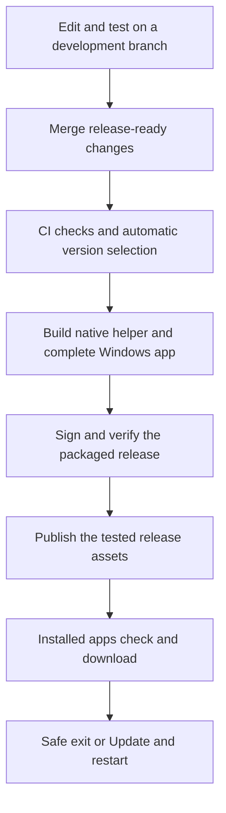

# Agent Notch automatic updates — research and proposed design

> Implemented in 0.17.9. See [automatic updates and public downloads](0.17.9-UPDATES.md) for the shipped behaviour, verification and remaining rollout limits. This document remains the original design research.

Researched 5 November 2026. This document proposes an implementation; it does not enable an updater, create a remote repository or publish a release.

The recommended starting point is the existing Electron/NSIS installer, with electron-updater in the app and GitHub Actions plus GitHub Releases for delivery. Windows NSIS is a supported auto-update target. The configured build produces release metadata such as latest.yml; the client uses its configured release provider to discover updates. [Official stable v26 update documentation](https://www.electron.build/v26/docs/features/auto-update/).

Friends install the first updater-enabled version once. Subsequent releases can download and install through the app. Existing 0.15.1 installations have no updater, so they cannot acquire this capability remotely without that initial upgrade. This follows from inspection of the current application, rather than a limitation of its installer format.

The application checks a release feed; publishing does not immediately push code into offline or closed laptops. Proposed checks: shortly after startup, every six hours while running, and a manual Check for updates command. A connection failure should leave the current app usable.

## Findings in the current checkout

| Area | Observed state | Proposed change |
| --- | --- | --- |
| package.json | Electron 44.5.1, electron-builder 26.x, Windows NSIS, per-user install | Keep this format; add a compatible pinned electron-updater runtime dependency and explicit publish destination. |
| App identity | app.agentnotch.desktop | Preserve it across releases and install folders. |
| Release infrastructure | No Git remote or tracked .github workflow configured in this checkout | Connect a repository; add test/build/release jobs. |
| src/main.cjs | No updater initialization; owns windows and native lifecycle | Add a main-process update service and a coordinated update shutdown. |
| src/preload.cjs | Version is duplicated as a hardcoded string | Expose the actual packaged app version through the existing IPC boundary. |
| Packaging | Includes a .NET Windows helper and managed Chromium resources | Build/restore both in CI; a JavaScript-only build would omit required functionality. |
| User data | Settings, encrypted credentials and SQLite are outside the installed application | Preserve them; validate migrations and update behavior with a populated test profile. |

These are local source findings, not features already implemented by this research.

The repository uses builder 26.x. Its unversioned documentation currently describes unreleased v27 behavior. Implementation should use the matching stable documentation and verify the selected dependency versions. In particular, do not assume v27 signed-manifest or install-on-next-launch APIs exist in the v26 stack. [Documentation version notice](https://www.electron.build/docs/features/auto-update/).

## Proposed developer workflow

Use a protected release branch: ordinary development pushes run tests; release-ready merges trigger the release pipeline. Thus, saving a file does not send unfinished changes to everyone. The official builder workflow supports building, signing and publishing through GitHub Actions. [GitHub Actions guide](https://www.electron.build/v26/docs/features/github-actions/).

For fully automatic numbering, semantic-release can infer versions and generate release notes from structured commit messages. For example, fix: reminder interaction produces a patch release and feat: new tool produces a minor release. The pipeline should seed its release history from the actual last public version, not assume every local installer was published. [Current semantic-release documentation](https://semantic-release.org/intro/).

Proposed release job sequence:

1. Check out the exact commit and release history; prevent two release jobs from running concurrently.
2. Install locked dependencies with npm ci and the SDK required by the native project.
3. Run the unit/regression checks. Select the new version before packaging and keep package.json/package-lock consistent.
4. Publish the self-contained native helper and its required DLLs/licenses. Restore the Chromium runtime matching the locked Playwright dependency. Do not rely on files present only on this development PC.
5. Build and sign one complete Windows release, with an explicit publish destination and its update metadata. Fail if the installer, metadata or expected runtime resources are absent.
6. Test the packaged artifact and its signatures. Hosted CI does not prove physical microphone, Discord-call or global-keyboard behavior; retain a beta/manual validation gate for relevant changes.
7. Publish those exact tested bytes. Keep one owner for publication: do not let separate release tools independently create or promote competing releases. A draft release can hold staged assets until validation finishes.

The native helper, browser resources and release assets should be reproducibly prepared on a clean Windows runner. Existing Windows-specific scripts need this validation before a workflow can be described as working.

## Hosting and publication

GitHub Releases is the simplest initial download host for this project. Each release asset must be under 2 GiB; the current approximately 352 MB installer fits that limit. A release can contain installers and release notes. [GitHub release documentation](https://docs.github.com/en/repositories/releasing-projects-on-github/about-releases).

Keep download assets publicly readable for public users. The private GitHub update provider expects client-side credentials and is documented as unsuitable for broad public distribution. Never embed the developer's publishing token in the application. A separate public downloads repository is possible, subject to the project's source-distribution/licensing requirements. [Updater provider guidance](https://www.electron.build/v26/docs/features/auto-update/).

Publishing credentials belong in CI secrets with minimum permissions. A same-repository release job can use the Actions token; a separate downloads repository requires an appropriately scoped publishing identity. [GitHub token permissions](https://docs.github.com/en/actions/tutorials/authenticate-with-github_token).

A generic HTTPS download host is an alternative if a custom domain/CDN is preferred. Its uploader and release promotion must be implemented separately. [Builder publish providers](https://www.electron.build/v26/docs/publish/). There is no need to operate a custom always-running update API for the recommended GitHub release-feed approach.

## Proposed user experience and shutdown

Download in the background, show progress in Settings, then offer Update and restart / Later. Installation on normal app quit is also supported. The tray app must distinguish hiding the island from actually quitting. Differential NSIS downloads can reduce transferred data, but full-download fallback must work; do not promise that every small code change produces a tiny download. [Stable NsisUpdater API](https://www.electron.build/v26/docs/api/electron-updater.class.nsisupdater/).

For Agent Notch, add an explicit preparing-for-update state before asking the updater to install. Refuse or defer installation during a voice recording, active agent action, capture, unsaved editor/export or live manual terminal session. Show the reason and let the user finish or explicitly end the work. Timers and reminders must retain their persisted state.

After an accepted update, flush drafts/settings/SQLite, release microphone and camera streams, stop queued speech, close browser and ConPTY jobs safely, and await native-helper termination. Then invoke the updater's supported install method. This requires special care: quitAndInstall closes windows before the usual before-quit notification, while this app currently calls app.quit from its main window's closed handler. Simply adding updater boilerplate would not establish safe shutdown. [Updater event ordering](https://www.electron.build/v26/docs/api/electron-updater.class.nsisupdater/).

Use an application update message rather than adding a duplicate Windows toast. Keep Check for updates, installed/new version, download state, errors and a defer option discoverable. Retry with backoff; never log API keys or command transcripts in update diagnostics.

## Trust, beta releases and recovery

Use HTTPS and signed Windows releases with publisher verification, and keep signing credentials out of source and user installations. Windows signing establishes publisher identity, but a certificate does not guarantee immediate SmartScreen reputation or the disappearance of all warnings. Microsoft's current guidance supersedes older claims that EV signing guarantees an instant bypass. [Microsoft SmartScreen guidance](https://learn.microsoft.com/en-us/windows/apps/package-and-deploy/smartscreen-reputation).

Start with an opt-in beta group, then promote to stable. Staged distribution can expand from a small percentage after validation. Recover from a bad release by publishing a higher-version hotfix containing the corrected or restored code; do not assume deleting a release downgrades already updated machines. [Staged rollout behavior](https://www.electron.build/v26/docs/features/auto-update/).

The repository already records unresolved public-redistribution considerations for existing bundled GPL material. Hosting and updater automation do not resolve those decisions. Preserve notices and complete the existing distribution review before broad public launch; see docs/crest-parity/LICENSE_DECISION.md.

## Proof required before giving the updater-enabled release to friends

Use two actual installed builds, for example 0.16.0 and 0.16.1, with a controlled beta feed. Prove discovery, background download, verification, installation, relaunch and the correct new running executable. Confirm Desktop/Start menu/startup targets and user data remain correct on both default and custom installation paths.

Also test offline checks, interrupted downloads, corrupt or wrongly signed artifacts, no-update checks, missing metadata, denied install permissions, a busy voice/task/terminal session and recovery from failed installation. Test preserved mute state, provider credentials, notes and populated reading/workout/water records. A development-mode notification or a generated installer alone is not an end-to-end update test.

The setup decisions needed are the release repository/download address, stable/beta policy and Windows signing identity. No repository, account, payment or credential is required merely to review this proposal. No end-to-end update delivery has been tested or enabled by this research.
