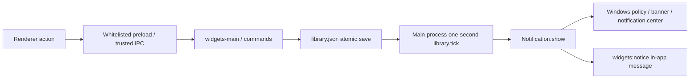

# Feature audit — 2026-11-03, before productivity implementation

## Observed baseline

The editable application is `island-fusion`, rather than the surrounding TwoCode executable. npm/package-lock manages dependencies. Agent Notch 0.8.0 uses Electron 44.5.1, Chromium and Node 24.21.0 in the desktop runtime; the shell's Node is 24.14.0. Its renderer is plain JavaScript/HTML with CSS and Web Animations, not React. State travels through a context-isolated, sandboxed preload. CSP prevents renderer network connections. Native Windows WASAPI, keyboard hooks, OCR, media and shell state are provided by the self-contained .NET 8 `native/IslandNative` helper. NSIS/electron-builder creates the per-user installer. Identity is `app.agentnotch.desktop`.

Current data: per-user `settings.json` (Windows-encrypted provider keys and preferences), atomic-renamed `library.json` (tasks, water, reminders, timers, notes/history), plus existing agent storage. Do not overwrite these files while the user's older tray process is running. A complete 0.8.0 source archive and installer are the baseline before this change; there is no useful repository Git checkout in this directory, so source archives/diffs provide review history.

The actual Electron binary was probed with a temporary file and supports `node:sqlite` / SQLite 3.53.4. This permits a transactional backend without a new native Node dependency.

## Actual files and flows

| Responsibility | Existing implementation |
|---|---|
| Window center, work area, DPI, sizing | `src/geometry.cjs`, `src/main.cjs` |
| Hover/collapse, one-second grace, spring animation | `src/island-motion.js`, `src/surface-motion.js`, `src/renderer.js` |
| Home, carousel and explicit tool drawer | `src/home-ui.js`, `src/widgets-ui.js` |
| Generic system media and controls | `src/widgets-main.cjs`, `src/widgets-ui.js`, `src/desktop-ui.js`, `native/IslandNative/Desktop.cs` |
| Water, general reminders, ToDo, Pomodoro/stopwatch | `src/library.cjs`, `src/widgets-main.cjs`, `src/widgets-ui.js` |
| Settings, startup, tray, app lifetime | `src/main.cjs`, `src/settings-status.cjs`, `src/preferences.js`, `src/languages-ui.js` |
| Notifications | `setupWidgets().notify()` in `src/widgets-main.cjs` |
| IPC trust and preload | `src/main.cjs`, `src/window-lifecycle.cjs`, `src/preload.cjs` |
| Voice intents | `src/commands.cjs`, `src/voice-main.cjs` |
| Gemini Live and secure audio | `src/gemini-live.cjs`, `src/live-playback.js`; preserve this completed work |
| Localization and quiet quotes | `src/i18n.js`, `src/localization.cjs`, `src/quiet.cjs`, `src/quotes.cjs` |
| Install/uninstall | `package.json`, `installer/consent.nsh`, `installer/cleanup-hooks.cjs` |

There are no React component reminder timers. The current main-process interval survives island collapse/hide. Timer/ToDo/general-reminder/water due calculations are combined in `library.tick`; quote scheduling and media/UI refresh timers are separate concerns. The new durable scheduler must replace notification scheduling, rather than introduce a second water dispatcher. Generic system media controls must remain independent of explicit Spotify Connect actions; each user action chooses one controller.

## Confirmed water blockers and weaknesses

Read-only inspection of the real installed profile found `water.enabled=false`, hours 08:00–22:00, interval 60 minutes, last reminder 0, and two preserved drink entries. Therefore no scheduled water toast can currently dispatch. Additionally, HKCU `Software/Microsoft/Windows/CurrentVersion/PushNotifications` reports `ToastEnabled=0`. OS notifications need enabling by the user in Windows Settings; do not modify that preference or bypass it with a substitute alert.

The Start Menu shortcut exists and its observed AppUserModelID matches `app.agentnotch.desktop`; its ToastActivatorCLSID is populated. The source already calls `app.setAppUserModelId`, acquires a single-instance lock, keeps a tray process, and registers the installed executable for login according to the saved preference/default. The running older installation was not killed or replaced during this audit.

Code confirms `.show()` is called. However, the current code marks reminders `fired` before attempting notification delivery, has no `show`/`failed`/activation diagnostics, no persisted notification center, no Windows action buttons, no explicit sound manager or preview, and no quiet-hours/lock/focus/backlog policy. `fired` therefore cannot mean the user saw an alert. Water's computed next time can also be stale outside its active window. These are reproducible code-level defects even after the two disabled settings are corrected.

`powerMonitor` currently updates quote suppression on suspend/resume/lock/unlock, but does not explicitly re-evaluate durable reminder occurrences. General reminders can all fire after a long sleep. Existing window/quote suppression uses shell notification state as a best-effort veto; it is not authoritative DND detection. Do not label unknown Windows DND as definitely off.

## Migration and implementation plan

1. Add a versioned SQLite productivity store under this app's profile, transactional migrations, pre-migration copies of legacy files, foreign keys and occurrence uniqueness. Preserve existing settings/keys and unrelated library features.
2. Import water logs/settings and legacy general reminders once. Route their existing actions and compact views to the new canonical store. Stop their legacy scheduler path. Route timer/ToDo completion events through the shared notification history without duplicating their timer calculations.
3. Use one clock-injected, main-process scheduler for typed recurrence, timezone/DST, idempotent occurrence actions, snooze, quiet windows and coalescing. Persist decisions before acknowledging actions. Recalculate after time/zone/wake changes and avoid missed-alert floods.
4. Add Windows notification diagnostics, retained notification objects, global activation routing and truthful history states. Sound follows Windows policy; a show event proves submission, not human visibility. Add explicit test controls and an OS Settings link.
5. Add separate book/course/workout entities, notes and session tracking; expose compact launcher summaries and an explicit detail window. No reminder is enabled merely by opening a module.
6. Add Spotify PKCE in the external browser, encrypted refresh tokens, device-based controls and supported metadata endpoints. No embedded Electron streaming claim. Account/client registration and actual playback require an eligible user account and remain separately verified.
7. Add localized core labels/reminders with English fallback for unreviewed text; preserve five language styles, quotes, safe dictation and compact centered geometry.

## Baseline executed

- 97 Node tests passed.
- Native .NET helper built successfully.
- Windows source desktop regression: 60 checks passed; typed-speech behavior: four checks passed.
- Source Settings save/scroll regression: 15 checks passed.
- Packaged 0.8.0 Gemini UI: 11 checks passed, including error persistence and cancellation; no microphone capture or cloud request.
- Packaged Settings save/scroll: 15 checks passed; packaged typed-speech check passed.
- All 62 packaged source files and the native helper matched the reviewed 0.8.0 files byte for byte.

Real Windows toast visibility/sound, locked/resumed delivery, Spotify authorization/playback and multi-monitor/DPI hardware cases are not yet verified. Global Windows notifications being disabled prevents claiming a visible toast test. The app being fully quit necessarily stops its ordinary tray scheduler.
