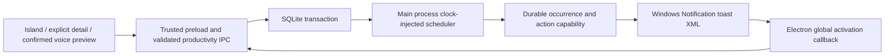

# Reminder architecture — 0.9.0

**Current presentation update:**0.10.0 uses notch reminders by default; Windows banners are an optional separately selected mode. The scheduler/storage architecture below is retained. See [0.10.0 behavior and migration](0.10.0-NOTCH-REMINDERS.md) for persistent notch cards, renderer acknowledgement, timers, refill tracking and busy/global controls. Windows-specific delivery sections below describe the optional bridge.

The ordinary Agent Notch tray process owns the scheduler. Collapsing or hiding the island and closing the detail panel leave it running. Fully quitting, signing out or shutting down stops it. Startup follows the existing saved Windows login preference; the default remains enabled, and an explicit opt-out is preserved.

## Data and routing

`productivity-store.cjs` opens `productivity.sqlite` under Electron's per-user application data directory, with WAL, FULL synchronous writes, foreign keys and a busy timeout. Schema version 1 includes preferences, typed book/course/workout records, notes, canonical page logs, lessons, activity sessions, water drinks, reminder rules, occurrences and action receipts. Sessions have a unique partial index allowing one active activity. Occurrences have UNIQUE(reminder_id, occurrence_key). Nested synchronous transactions use savepoints; asynchronous work cannot escape a transaction.

Before the initial migration, existing `settings.json` and `library.json` are copied to `backups/before-productivity-v1`. Water settings/logs and general reminders import once. The original files remain available. Disabled schedules stay disabled. `widgets-main.cjs` adapts the existing Water UI to this canonical store and calls the old library tick with managed reminders disabled. Todo and timer calculations remain in the legacy library, but their alerts enter the same occurrence history. There is one water dispatcher and one notification sound path.

## Time, delivery and actions

`reminder-time.cjs` uses IANA zones and local calendar dates for daily times, chosen weekdays, multiple times, intervals in a window (including overnight), and one-off timestamps. Intervals exclude the window's closing boundary. Water auto-fit places the expected number of servings within the window; custom intervals remain available. A missing DST wall time is skipped; a repeated fall-back wall time uses its first occurrence only. Follow-system schedules recalculate after a timezone change; fixed-zone schedules retain their zone. Backward clock changes also recalculate future times.

`reminder-engine.cjs` ticks in the main process once a second. It persists a due occurrence before submitting a toast. The lifecycle includes queued, dispatching, delivered, deferred, missed, snoozed, completed, skipped, dismissed, failed and unknown. A Windows `show` event is recorded as submitted, with visibility and audibility explicitly unknown. A failure remains failed without an automatic retry loop. A timeout or a crash during dispatch becomes unknown; explicit Retry is available. History clearing hides rows rather than destroying de-duplication records.

Windows actions carry an occurrence ID and unpredictable capability token. The database commits progress before acknowledging it. Double-clicking +250 ml cannot log twice. Snoozing persists an absolute timestamp and rotates the token on re-delivery; the selection offers 5, 10, 15 and 30 minutes. The toast exposes a relevant primary action, Snooze and Dismiss. Open, Skip today, Retry and other history actions are also available in Notification Center. Skip today suppresses the full local date. Archived, deleted, paused and completed targets suppress queued reminders. Reaching the water goal suppresses queued water alerts unless the user elected to continue.

## Interruptions and sound

Global/category switches, quiet hours, locked/suspended state, shell presentation/full-screen state, active activity sessions and Pomodoro focus constrain delivery. High priority may pass app focus rules; it does not override Windows or quiet hours. The Windows helper reports global/app notification settings and WinRT notifier status. DND remains **unknown** where no authoritative API is available. Windows retains final control of banners, Action Center and sound.

Overdue alerts older than five minutes become missed. Optional catch-up produces at most one summary. Deferred backlog is combined; configured grouping coalesces reminders within two minutes. A daily cap limits prompts. No overdue flood is replayed after wake. Quiet policy may defer or skip. Lock/sleep pauses active session time, and wake/unlock recalculates scheduling. Functional notifications suppress motivational quotes.

Scheduled sound comes only from the toast's `ms-winsoundevent` audio. Categories and individual schedules choose Windows notification/message/mail/reminder cues or silence. Arbitrary local file paths are not advertised as custom Windows toast sounds. The preview uses the corresponding Windows registry-assigned WAV via the existing native WASAPI helper, at the chosen preview volume. Scheduled alerts use Windows volume and DND controls; the preview slider is explicitly labeled accordingly. Media mute can consult cached Spotify and existing system media state. There is no extra renderer sound layered over a toast.

## Sessions, confirmation and recovery

Reading, learning and workout clocks use main-process monotonic elapsed time, not renderer intervals. Checkpoints run every 15 seconds. Clean shutdown, lock and suspend pause them; restart restores a paused checkpoint. An abrupt process crash may lose at most the last checkpoint interval of active time. Timer expiry never completes a book, lesson or workout automatically. Progress and notes commit immediately on Save; unsaved form drafts are not guaranteed after process termination.

Voice/text intents prepare an expiring on-screen preview. Confirm is required before logging pages/water, completing lessons, changing schedules, starting activities or requesting Spotify playback. Gemini receives a prepare-only tool, never a confirmation tool. Receipt IDs prevent replay; stale page previews are rejected.

Notification Center exports a standalone SQLite backup via VACUUM INTO. Restore requires confirmation, validates header/version/integrity/table shape, rejects views/triggers and oversized files, checks content and foreign keys, and replaces data transactionally. A rollback copy is created under `backups/before-restore-*`. Imported activity sessions pause, pending occurrences are not replayed, and future schedules recalculate. Credentials and other legacy app data are outside this backup. Notes can also export as Markdown or JSON without rewriting personal text.

## Verification boundary

Deterministic tests cover DST, snooze across midnight, timezone change, grouping, long sleep, disabled OS notifications, idempotent actions, failure/retry, water goal changes, legacy import and backup rollback. Windows UI tests exercise persistence and timers with panels closed. The initial test correctly deferred while Windows notifications were disabled (`DisabledForUser`). After the user enabled notifications, the packaged 60-second hidden-island test recorded delivery with notifier status `Enabled`; the user confirmed a visible banner with sound. The automated report retains its submission-only wording; `artifacts/0.9.0/user-observed-banner.json` records the separate human observation. Physical toast button clicks, other sound profiles/preview volume, and sleep/lock hardware testing remain **NOT VERIFIED**. See `manual-windows-qa.md`.
